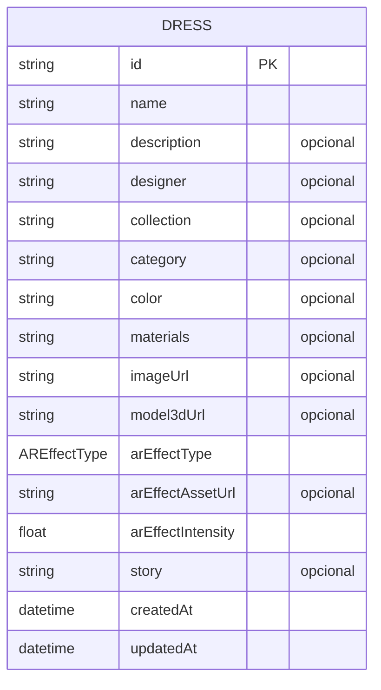
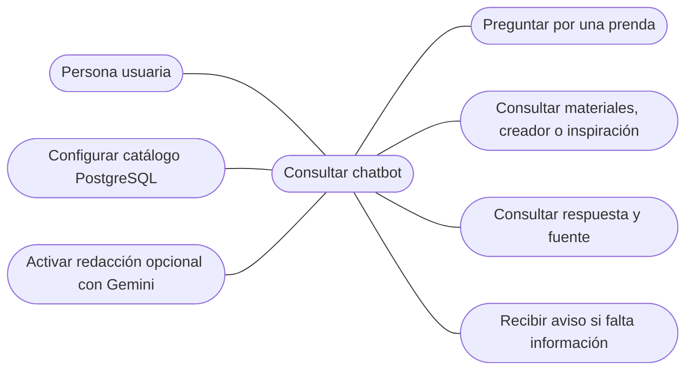
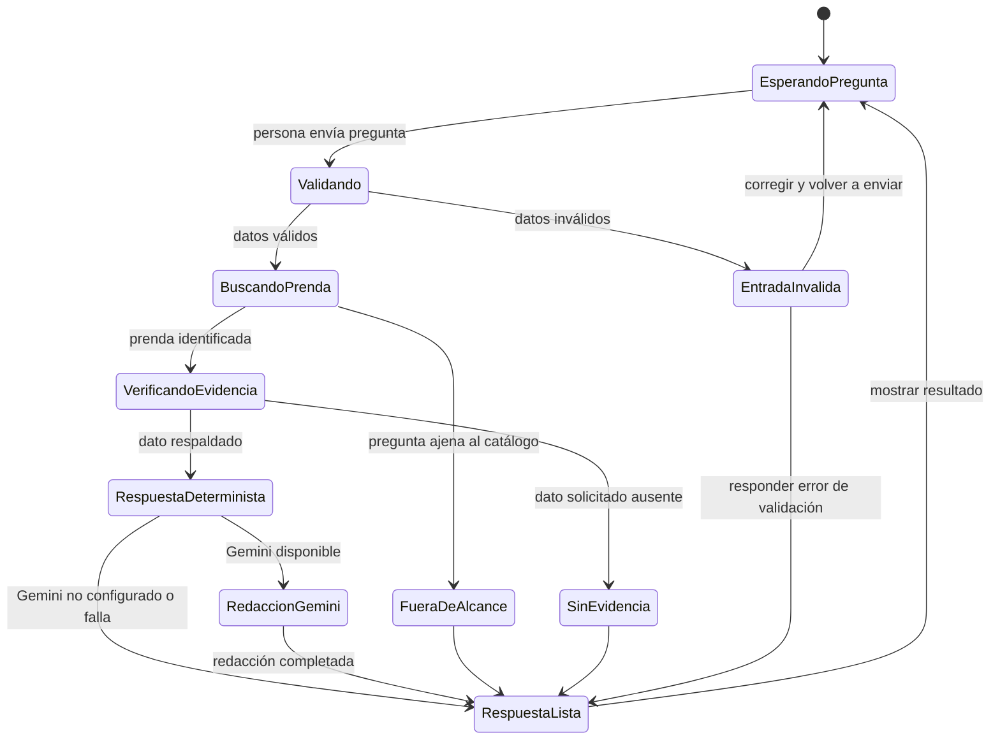

# Diagramas del proyecto Fashion-IA

Este documento reúne los diagramas Entidad-Relación, casos de uso y máquina
de estados del proyecto. Los diagramas reflejan el modelo de datos y el flujo
actual del chatbot.

## 1. Diagrama Entidad-Relación

El modelo persistido actual contiene una entidad `Dress`. Sus atributos
opcionales están indicados en el diagrama. No se incluyen relaciones porque
el esquema actual no define otras entidades relacionadas.

## 2. Diagrama de casos de uso

## 3. Diagrama de máquina de estados de una consulta

