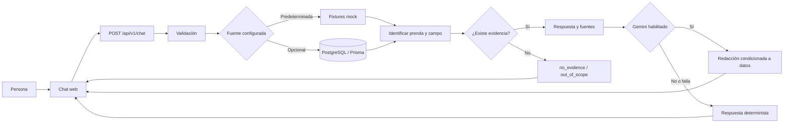

# Informe de progreso | Fashion-IA — Chatbot de moda

**Fecha de corte (fase 1):** 17 de octubre de 2026  
**Actualización de la fase 3:** 30 de octubre de 2026 (ver sección 1.1)  
**Producto:** Fashion-IA / Fashion AR Runway  
**Módulo evaluado:** Chatbot de catálogo  
**Equipo de desarrollo del período informado:** PM Michael Zuleta · Backend Dario Borja · Frontend Juan Henao
**Equipo de desarrollo del período informado - FASE 3:** PM Miguel Ángel Muñoz Sosa · Backend Brayan Rojas · Frontend Wudeison Tovar

> Este informe reúne evidencia comprobable del código, las pruebas, una consulta funcional y las tarjetas visibles de Trello, además de la planificación de capacidad del equipo para una semana de trabajo. La distribución por persona-días representa el plan de trabajo y no un registro horario individual.

> **Nota sobre KPIs:** los objetivos y la capacidad se presentan como planificación del equipo para una semana laboral de cinco días, con participación de los tres integrantes. Los resultados de pruebas y estados de Trello se presentan aparte como evidencia observada.

## 1. Resumen ejecutivo

El módulo de chatbot cuenta con una interfaz web funcional conectada a un endpoint REST versionado. Puede contestar preguntas sobre un catálogo ficticio, identificar campos y prendas por texto, devolver referencias a los registros usados y manejar falta de evidencia y preguntas fuera de alcance. El catálogo PostgreSQL y la redacción opcional con Gemini están soportados en el código, pero dependen de configuración y no deben confundirse con una ingesta documental ya implementada.

La respuesta es determinista por defecto. Gemini puede redactar con datos recuperados, pero no sustituye la fuente de verdad y el backend conserva la respuesta base si la redacción falla.

### 1.1 Actualización de la fase 3 (30 de octubre de 2026)

La fase 3 mejora la interfaz y amplía el conocimiento del chatbot. El Home con
cámara simulada, el chat rediseñado, la respuesta en vivo y el catálogo con
colores, estilo y temporada ya están implementados y probados con el catálogo mock.

**Equipo y responsabilidades**

| Rol | Integrante | Responsabilidad en la fase 3 |
|---|---|---|
| PM | Miguel Ángel Muñoz Sosa | Lista de actividades, división de responsabilidades y autor del mockup actualizado de la interfaz (paleta y diseño del chat) |
| Backend | Brayan Rojas | Campos de colores, estilo y temporada; respuesta en vivo (`POST /api/v1/chat/stream`); Gemini sobre el catálogo completo; migración de PostgreSQL |
| Frontend | Wudeison Tovar | Home con cámara simulada, botón flotante, tarjeta de prenda detectada, chat rediseñado, sugerencias, emojis y animaciones |

**Lista de actividades de la fase 2**

| Actividad | Responsable | Estado |
|---|---|---|
| Home con cámara simulada (sin cámara real) | Frontend | Hecho |
| Botón flotante al chat, disponible en cualquier momento | Frontend | Hecho |
| Tarjeta de prenda detectada con "Ver más información…" que abre el chat con esa prenda | Frontend | Hecho |
| Chat rediseñado según el mockup actualizado, respetando su paleta | Frontend / PM (mockup) | Hecho |
| Sugerencias para seguir explorando después de cada respuesta, con emojis y animaciones | Frontend | Hecho |
| Catálogo con materiales, estilo, temporada y colores (mock, PostgreSQL y seed) | Backend | Hecho; la migración debe aplicarse con `npx prisma migrate dev` |
| Respuesta en vivo: `POST /api/v1/chat/stream` (SSE) | Backend | Hecho |
| Respuestas abiertas con Gemini usando solo el catálogo | Backend | Hecho en código; sin validar contra Gemini real (requiere `GEMINI_API_KEY`) |
| Pruebas automatizadas de lo nuevo | Backend / Frontend | Hecho |
| Cámara real y reconocimiento visual de prendas | Por definir | Pendiente |
| Documento oficial y datos reales en PostgreSQL | PM / Backend | Pendiente |

**Validación técnica de la fase 2**

| Comprobación | Resultado |
|---|---|
| Pruebas backend | 58/58 aprobadas en 8 suites |
| Pruebas frontend | 29/29 aprobadas en 8 archivos |
| Build de producción frontend | Aprobado |
| Linter frontend | Una advertencia previa (`react(set-state-in-effect)` en `DressDetailPage`), sin errores |
| Prueba local con el backend en modo mock | Home → "Ver más información…" → chat → pregunta respondida con el catálogo mock |

No se validó la migración contra una instancia de PostgreSQL ni la redacción
con Gemini real. Sin Gemini, las preguntas abiertas sobre el catálogo completo
responden `no_evidence`; las reglas deterministas cubren una prenda y un campo
por pregunta.

**Cambios respecto a los pendientes de la fase 1:** la simulación de prenda
detectada ya abre el chat con contexto. El flujo con cámara real y
reconocimiento visual, la ingesta del documento oficial y la persistencia de
sesiones siguen pendientes.

## 2. KPIs y capacidad planificada para una semana de trabajo

### Incorporación de integrantes — 22 de octubre de 2026

Se incorporan al equipo Miguel Ángel Muñoz Sosa (PM, identificación reportada:
202110078), Deison Tovar Cruz (Frontend) y Brayan Stiven Rojas Fernández
(rol no especificado). La intervención registrada hasta la fecha fue una sesión
de **2 horas en total** para explicar el estado actual del proyecto, las ideas,
las metas y las tecnologías utilizadas. Fue una sesión de socialización; no se
registran tareas de implementación ni entregables de estas personas.

La sesión ocurrió después del período de cinco días usado en los KPIs de este
informe. Por ello, la capacidad planificada y los resultados históricos que
siguen se mantienen referidos al equipo del período inicial y no se recalculan
como si la sesión hubiera sido trabajo de desarrollo.

#### Validación técnica realizada el 22 de octubre de 2026

| Comprobación | Resultado |
|---|---|
| Pruebas backend | 48/48 aprobadas en 7 suites |
| Pruebas frontend | 14/14 aprobadas en 5 archivos |
| Build backend | Aprobado |
| Build de producción frontend | Aprobado |
| Linter frontend | Ejecutado; 2 advertencias existentes de `react(set-state-in-effect)`, sin errores |
| Prueba local integrada | Frontend y health del backend respondieron HTTP 200; el chatbot respondió `answered` con catálogo mock |

La prueba de integración local valida el modo mock; no acredita una conexión
activa a PostgreSQL ni a Gemini.

### Supuestos de planificación

- Duración del período: **1 semana = 5 días hábiles**.
- Equipo considerado: **3 integrantes** — Michael (PM), Dario (Backend), Juan (Frontend).
- Dedicación según el PM: los tres integrantes trabajaron durante toda la semana.
- Capacidad planificada del equipo: **15 persona-días** (3 personas × 5 días). Se usa como unidad de planificación y distribución de tareas.
- El alcance evaluado es el **MVP del chatbot y su demo funcional**. La ingesta del documento oficial y el flujo completo AR → chatbot siguen siendo trabajo posterior, no se consideran terminados dentro del MVP.

### Distribución planificada de capacidad

| Responsable / paquete de trabajo | Persona-días planificados | Porcentaje de capacidad | Trabajo considerado |
|---|---:|---:|---|
| Michael Zuleta — PM | 3 | 20% | Alcance, criterios de aceptación, coordinación, documentación y preparación de demo |
| Dario Borja — Backend | 6 | 40% | Contrato API, lógica del chatbot, fuentes mock/DB, referencias, validación y pruebas |
| Juan Henao — Frontend | 4 | 26.7% | Interfaz conversacional, integración API, estados de carga/error y presentación |
| QA e integración del equipo | 2 | 13.3% | Validación funcional, regresión, revisión del recorrido de demo y ajustes compartidos |
| **Total planificado** | **15** | **100%** | Capacidad del equipo para la semana |

La asignación distribuye la capacidad del período entre los paquetes de trabajo; no es un timesheet por integrante. El trabajo de QA/integración es compartido y no se adjudica a una persona específica.

### Plan semanal de trabajo

| Día hábil | Enfoque previsto | Resultado esperado |
|---|---|---|
| Día 1 | Alinear alcance, preguntas objetivo, contrato conversacional y experiencia visual | Criterios y estructura del MVP acordados |
| Día 2 | Implementar contrato/API y construir la interfaz del chat | Primer flujo frontend-backend disponible |
| Día 3 | Completar búsqueda de prenda/campo, fuentes y estados; conectar la UI | Respuesta de catálogo visible desde el chatbot |
| Día 4 | Añadir validaciones, manejo de errores, pruebas y revisión de límites | Flujo estable ante éxito y casos sin evidencia |
| Día 5 | Regresión, prueba manual, documentación y preparación de demo | MVP documentado y demostrable; pendientes reales identificados |

Esta distribución representa una secuencia sugerida para una semana y no permite inferir qué actividad ocurrió exactamente en cada fecha.

### KPIs objetivo del MVP semanal

| KPI objetivo | Meta del período | Estado frente a la evidencia disponible |
|---|---:|---|
| Entrega del flujo conversacional de demo | 1 flujo funcional | Alcanzado en la prueba manual del catálogo mock |
| Estados de negocio cubiertos | 3 (`answered`, `no_evidence`, `out_of_scope`) | Implementados y cubiertos por pruebas |
| Rutas principales del chat integradas | 1 endpoint versionado | `POST /api/v1/chat` conectado a la interfaz |
| Fuentes de catálogo preparadas | 2 (mock y PostgreSQL) | Ambas soportadas por código; mock verificado en demo, DB requiere configuración/datos |
| Automatización de regresión | Suite backend y frontend ejecutable | Aprobada en la validación reportada; ver conteos observados abajo |
| Lectura del documento oficial | 0 documentos conectados dentro del MVP mock | Pendiente, explícitamente fuera de la entrega mock |
| Integración contextual cámara/pasarela → chatbot | 0 flujos completos dentro del MVP mock | Pendiente de integración |

Las metas son **objetivos de planificación del período**, no métricas capturadas automáticamente por una herramienta de seguimiento. Los ítems pendientes no deben contarse como fallos del MVP mock: delimitan el trabajo posterior de integración real.

## 3. Indicadores observados y evidencia técnica

Los números de esta sección son resultados observados en las ejecuciones y revisiones disponibles; se mantienen separados de los objetivos de planificación.

| Indicador | Resultado a la fecha de corte | Evidencia / interpretación |
|---|---:|---|
| Pruebas automatizadas backend | **48/48 aprobadas** | 7 suites Jest |
| Pruebas automatizadas frontend | **12/12 aprobadas** | 4 archivos Vitest |
| Pruebas aprobadas en total | **60/60** | Ejecuciones registradas durante la validación del proyecto |
| Estados conversacionales | **3** | `answered`, `no_evidence`, `out_of_scope` |
| Fuentes de catálogo soportadas | **2** | Fixtures mock y PostgreSQL; el mock es el modo predeterminado |
| Pregunta manual de humo | **Correcta** | Consulta de materiales de “Vestido Aurora de Jardín”: `answered`, con fuente mock |
| Errores de API contemplados | **5 códigos principales** | Validación, tipo de contenido, método, límite de solicitudes y fuente no disponible |
| Tarjetas con control explícito de completado en Trello | **6 completadas / 5 abiertas** | Conteo visible de controles en las listas revisadas; excluye tarjetas sin control de completado y la tarjeta genérica “Start using Trello” |
| Ingesta de documentos externos | **Pendiente** | No hay cargador de PDF/Word/documento conectado al chatbot |
| Sesión conversacional persistente | **Pendiente** | `sessionId` se valida, no se guarda ni genera memoria |

**Cómo interpretar el conteo de Trello:** seis tarjetas muestran el estado completado (cuatro entregables de Sprint 0 que ya estaban marcados y dos tareas P1 que se completaron en esta actualización); cinco tarjetas muestran control de completado pero siguen abiertas. Otras tarjetas activas visibles no presentan ese control, por lo que no se incorporan a esta cuenta. No se presenta un porcentaje global porque la cobertura del conteo no incluye todas las tarjetas ni está ponderada por esfuerzo.

## 4. Estado por área

Los responsables se muestran por **función del equipo** y según la distribución informada por el PM. No se pretende inferir quién escribió cada línea o commit.

| Área / función | Estado | Avance observado |
|---|---|---|
| **PM — Michael Zuleta** | En curso | Definición y priorización del módulo; documentación de alcance y siguiente etapa preparada. Trello revisado; se actualizaron estados y comentarios de avance, con las tareas dependientes de la fuente real mantenidas abiertas. |
| **Backend — Dario Borja** | Funcional para demo | Contrato `POST /api/v1/chat`, validación, carga de catálogo mock y DB opcional, lógica determinista, estados de negocio, referencias de fuente, límites y fallback de Gemini. Tests automatizados aprobados. |
| **Frontend — Juan Henao** | Funcional para demo | Interfaz conversacional, envío de preguntas, indicador de carga, respuesta y ficha de prenda conectados al endpoint. Flujo conversacional validado manualmente. |
| **Integración AR y chatbot** | Parcial (fase 2) | La simulación del Home abre el chat con la prenda "detectada". El paso desde la cámara real y el reconocimiento visual siguen pendientes. |
| **Conocimiento documental** | Pendiente | No se ha conectado el documento de referencia ni implementado extracción, indexación o recuperación de fragmentos. |

## 5. Entregables completados

- [x] Interfaz web para iniciar y continuar una conversación.
- [x] Integración del frontend con `POST /api/v1/chat`.
- [x] Contrato versionado con respuestas y estados de negocio definidos.
- [x] Búsqueda por nombre/alias de prenda y detección de los campos consultados.
- [x] Respuestas deterministas sobre materiales, creador e inspiración.
- [x] Respuestas controladas para datos ausentes y preguntas fuera del catálogo.
- [x] Referencias de respuesta mediante `sources` y metadatos sobre el origen mock.
- [x] Modo de demo con catálogo de fixtures, sin requerir PostgreSQL.
- [x] Soporte de código para catálogo PostgreSQL mediante la configuración `CHATBOT_SOURCE=db`.
- [x] Integración opcional de Gemini como redactor, con respuesta determinista de respaldo.
- [x] Manejo de validación, tamaño de cuerpo, métodos HTTP, tipo de contenido y rate limit del endpoint.
- [x] Validación automatizada: 48 pruebas backend y 12 frontend aprobadas.
- [x] Prueba manual de pregunta y respuesta desde el chatbot web.
- [x] Documentación de presentación, arquitectura, tecnologías, alcance y guion de demo.

> La presencia de soporte de PostgreSQL o Gemini en el código no prueba que esas fuentes estén activas, configuradas y validadas en el entorno de presentación. La demo comprobada respondió usando `meta.mock: true`.

## 6. Pendientes y siguiente trabajo recomendado

| Prioridad | Tarea | Criterio de salida recomendado |
|---|---|---|
| Alta | Confirmar y normalizar el documento oficial de referencia | PM aprueba fuente, contenido y campos por vestido; cada dato queda asociado a su procedencia |
| Alta | Cargar y validar los datos reales en PostgreSQL | Prueba de extremo a extremo con fuente `db`, registros reales y `meta.mock: false` |
| Alta | Integrar la prenda detectada con el contexto conversacional | Desde el flujo de pasarela se identifica/selecciona un vestido y se abre el chat con ese contexto |
| Media | Diseñar ingesta documental si la fuente no es solo tabular | Extracción, segmentación, recuperación de fragmentos y referencias al documento/sección |
| Media | Añadir persistencia de sesiones si se necesita memoria | Sesiones almacenadas, asociadas a un usuario/identificador y con política de retención definida |
| Media | Ampliar cobertura con datos reales y preguntas representativas | Casos de prueba por vestido/campo, campos vacíos, nombres ambiguos y respuestas sin evidencia |
| Antes de producción | Revisar operación y seguridad | Autenticación si aplica, rate limit escalable, gestión de claves, logging y despliegue monitorizado |
| Gestión | Aprobar alcance de la integración real | PM confirma la fuente oficial, prioridades y condiciones para dar por aceptada la integración real |

## 7. Flujo funcional de la versión actual

## 8. Criterios de aceptación para la siguiente demo

- [ ] PM confirma el documento/fuente oficial y los datos autorizados para mostrar.
- [ ] Backend configura la fuente de datos real en el entorno de demo y comprueba `meta.mock: false`.
- [ ] Una pregunta correcta sobre un vestido real devuelve los campos y referencias esperados.
- [ ] Una pregunta por un campo no documentado devuelve `no_evidence`, sin completar información inventada.
- [ ] Frontend puede acceder al chatbot desde el flujo acordado (independiente o contextual desde la pasarela).
- [ ] Se repiten las pruebas automatizadas y se archivan resultados de la versión presentada.
- [ ] Se valida acceso seguro a cualquier clave de proveedor y se evita publicarla en documentación o tablero.

## 9. Fuentes de evidencia del informe

- [Guía de presentación del proyecto](./presentacion-proyecto.md)
- [Contrato del chatbot v0.1](../backend/docs/chatbot-contract-v0.1.md)
- [Documentación técnica del backend](../backend/docs/chatbot-backend-pm.md)
- Implementación del endpoint: `backend/src/routes/chatV1.routes.ts`
- Lógica del catálogo: `backend/src/chatbot/catalog.ts` y `backend/src/chatbot/handler.ts`
- Pruebas del endpoint: `backend/src/__tests__/chatbot.api.test.ts`
- Interfaz y cliente: `frontend/src/App.tsx` y `frontend/src/services/chatService.ts`
