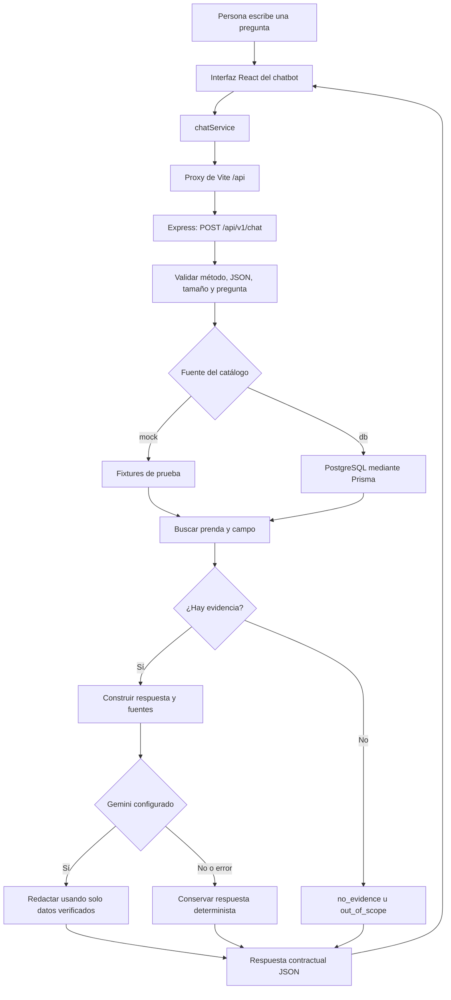
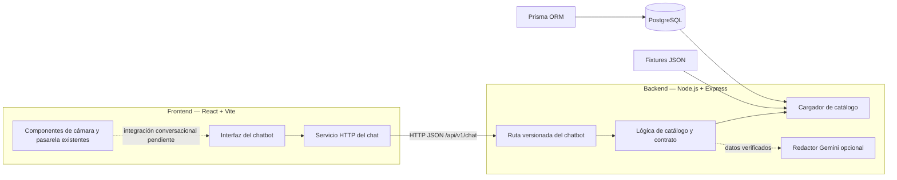
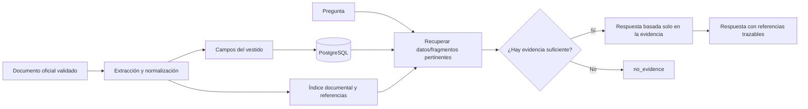

# Fashion-IA | Fashion AR Runway

> **Guía de presentación y referencia del proyecto**  
> Documento preparado para leerse en Markdown y exportarse a PDF. Los diagramas usan Mermaid.

## 1. Resumen ejecutivo

Fashion-IA es un prototipo para acercar al público a los diseños de una colección de moda mediante una experiencia web. El módulo priorizado para esta entrega es el **chatbot**, que permite preguntar por prendas y responde con información respaldada por el catálogo disponible.

El chatbot funciona hoy con un catálogo de prueba y una interfaz web propia. El backend también contempla consultar los vestidos guardados en PostgreSQL. Gemini es opcional: puede ayudar a redactar respuestas, pero no es la fuente de los datos ni decide qué información es válida.

### Idea central

**Preguntar sobre una prenda → identificar el dato en el catálogo → responder con información trazable y sin inventar atributos.**

## 2. Equipo y responsabilidades

### Equipo que desarrolló el MVP documentado

| Responsabilidad | Integrante |
|---|---|
| Product Manager (PM) | **Michael Zuleta** |
| Backend | **Dario Borja** |
| Frontend | **Juan Henao** |

### Integrantes incorporados

| Integrante | Rol / identificación reportada |
|---|---|
| **Miguel Ángel Muñoz Sosa** | PM · 202110078 |
| **Deison Tovar Cruz** | Frontend |
| **Brayan Stiven Rojas Fernández** | Integrante; rol no especificado |

Su participación documentada hasta la fecha fue una sesión de **2 horas** de
socialización del estado del proyecto: alcance actual, ideas, metas y
tecnologías utilizadas. Esta sesión fue explicativa; no se atribuyen a estas
personas tareas de desarrollo, entregables ni horas adicionales.

## 3. Alcance del producto y estado actual

El repositorio reúne el prototipo Fashion AR y el módulo conversacional. **La pantalla de inicio que está conectada actualmente en el frontend de esta entrega es el chatbot**. En el código también existen pantallas y componentes para pasarela, cámara, escaneo y detalle del vestido; conectarlos en una única navegación de principio a fin es trabajo de integración pendiente.

| Capacidad | Estado |
|---|---|
| Interfaz web para conversar con el chatbot | Implementada |
| API `POST /api/v1/chat` | Implementada |
| Catálogo ficticio para demo, sin base de datos | Implementado y usado por defecto |
| Consulta de prendas desde PostgreSQL | Implementada como fuente opcional; requiere configurar y cargar la base de datos |
| Gemini para reformular respuestas con datos ya verificados | Opcional; necesita configuración y una clave válida |
| Respuestas deterministas cuando Gemini no se usa o falla | Implementadas |
| Lectura de un documento externo como fuente de conocimiento | Pendiente |
| Sesiones e historial conversacional persistente | Pendiente; `sessionId` se valida, pero no se almacena ni se usa para memoria |
| Flujo integrado cámara → prenda reconocida → chatbot contextual | Pendiente de integración |

## 4. Flujo de uso del chatbot

1. La persona escribe una pregunta en la interfaz.
2. El frontend la envía como JSON al backend.
3. El backend valida la solicitud y carga el catálogo configurado.
4. El manejador busca una prenda y el dato solicitado.
5. Si hay evidencia, construye respuesta, prenda y fuentes. Si no la hay, informa `no_evidence`; si la pregunta no corresponde al catálogo, informa `out_of_scope`.
6. Gemini puede mejorar la redacción cuando está configurado. Si falla, se conserva la respuesta determinista.
7. El frontend muestra la respuesta y, si fue identificada, una ficha de la prenda.



## 5. Arquitectura



    Los diagramas Entidad-Relación, casos de uso y máquina de estados están
    reunidos en el documento [Diagramas del proyecto](./diagramas-proyecto.md).

    ### Componentes principales

| Componente | Responsabilidad |
|---|---|
| `frontend/src/App.tsx` | Interfaz conversacional activa: historial de la sesión en pantalla, campo de pregunta, estado de carga y ficha de vestido |
| `frontend/src/services/chatService.ts` | Envía la pregunta y procesa errores HTTP |
| `backend/src/routes/chatV1.routes.ts` | Endpoint, validación HTTP, límite de solicitudes y formato de errores |
| `backend/src/chatbot/handler.ts` | Identifica prendas/campos y produce respuestas deterministas |
| `backend/src/chatbot/catalog.ts` | Carga los fixtures o adapta registros de PostgreSQL al contrato |
| `backend/src/chatbot/aiAnswer.ts` | Integración opcional con Gemini y fallback determinista |
| `backend/prisma/schema.prisma` | Modelo de datos de las prendas |
| `frontend/src/pages/` y `frontend/src/features/` | Vistas y componentes de pasarela, cámara, AR, vestidos y chat contextual disponibles en el repositorio |

## 6. Tecnologías y función

| Tecnología | Uso en el proyecto |
|---|---|
| React y TypeScript | Componentes e interfaz web con tipos para solicitudes y respuestas |
| Vite | Servidor de desarrollo, compilación y proxy `/api` hacia el backend |
| CSS y Tailwind CSS | Presentación visual; la pantalla conversacional actual combina estilos propios con utilidades en las vistas existentes |
| Node.js y Express | API REST y procesamiento de solicitudes |
| Prisma y PostgreSQL | Modelo y acceso a vestidos cuando se selecciona la fuente `db` |
| Gemini (`@google/genai`) | Redacción opcional condicionada a los datos que entrega el catálogo |
| MediaDevices API | Acceso a cámara en los componentes de la pasarela; requiere permiso y contexto seguro |
| Three.js, Canvas/CSS y PWA/Workbox | Dependencias y soporte para visualización/instalación web; no equivalen por sí solos a reconocimiento visual real |
| Jest y Supertest / Vitest | Pruebas del backend HTTP y del frontend |

**Nota sobre AR:** la cámara del navegador entrega video con permiso del usuario. El reconocimiento que describe el MVP es simulado; no se debe presentar como un modelo de visión artificial ya entrenado o conectado.

## 7. Alcances del chatbot hoy

### Puede hacer

- Responder preguntas de catálogo sobre materiales, creador e inspiración.
- Encontrar una prenda mediante su nombre completo, nombre sin tipo o alias no ambiguo.
- Responder preguntas generales sobre una prenda identificada usando los campos disponibles.
- Informar cuando falta un dato (`no_evidence`) o la consulta es ajena al catálogo (`out_of_scope`).
- Indicar qué registro/documento y campos respaldan la respuesta mediante `sources`.
- Usar reglas deterministas sin depender de una API externa.
- Usar Gemini opcionalmente para redactar, sin delegarle la selección de la fuente ni la veracidad de los campos.

### Todavía no hace

- Leer automáticamente PDF, Word, páginas web u otros documentos de referencia.
- Responder de forma fiable sobre datos que no estén en el catálogo conectado.
- Reconocer una prenda real a partir de una imagen o video; la detección actual es simulada.
- Mantener memoria entre mensajes o usuarios; el historial visible es local a la interfaz.
- Resolver preguntas generales ajenas a las prendas.
- Identificar páginas o párrafos de una fuente documental externa; `sources` identifica el registro y los campos usados.

## 8. Contrato de la API

**Ruta:** `POST /api/v1/chat`  
**Contenido:** `application/json`

### Solicitud

```json
{
  "question": "¿De qué materiales está hecho el Vestido Aurora de Jardín?"
}
```

`question` es obligatorio y acepta entre 1 y 500 caracteres. `sessionId` es opcional y debe tener formato UUID; actualmente solo se valida.

### Respuesta de negocio

```json
{
  "requestId": "req_0001",
  "status": "answered",
  "answer": "El Vestido Aurora de Jardín está confeccionado con los materiales del catálogo.",
  "garment": {
    "id": "VST-001",
    "name": "Vestido Aurora de Jardín",
    "type": "vestido",
    "creator": "Nombre del creador",
    "materials": ["material registrado"],
    "inspiration": "Inspiración registrada"
  },
  "sources": [
    {
      "recordId": "VST-001",
      "document": "catalogo-mock.json",
      "fields": ["materials"]
    }
  ],
  "meta": { "contractVersion": "0.1", "mock": true }
}
```

Estados de negocio: `answered`, `no_evidence`, `out_of_scope`. Los errores HTTP incluyen `VALIDATION_ERROR`, `UNSUPPORTED_MEDIA_TYPE`, `METHOD_NOT_ALLOWED`, `RATE_LIMITED` o `UPSTREAM_UNAVAILABLE`, junto con `requestId`.

`meta.mock` informa si la fuente de datos es ficticia; **no indica si se utilizó Gemini**.

## 9. Fuentes de información: ahora y siguiente etapa

### Hoy

- **Mock:** `backend/src/chatbot/fixtures/catalogo-mock.json`. Es la opción predeterminada de la demo; no necesita PostgreSQL.
- **Base de datos:** al configurar `CHATBOT_SOURCE=db`, el cargador consulta los vestidos de PostgreSQL. Convierte `designer` en `creator`, separa `materials` y usa `story` como `inspiration`.
- **Documento de referencia:** aún no está conectado al chatbot. Los fixtures y los registros estructurados no son una ingesta de documentos.

### Cuando se conecte el documento de referencia y los datos reales

La fuente aprobada debería convertirse en conocimiento consultable, no en texto libre que Gemini pueda completar por su cuenta:

1. Acordar el documento oficial y validar nombres, materiales, autoría e inspiración con el equipo.
2. Extraer y normalizar los datos por vestido; conservar identificadores y procedencia.
3. Para campos estructurados, cargar la información a PostgreSQL y usar el cargador `db` existente.
4. Si hay contenido narrativo no estructurado, incorporar ingesta y recuperación documental (por ejemplo, fragmentos indexados con referencia al documento y ubicación).
5. Recuperar únicamente fragmentos pertinentes para cada pregunta y pasarlos como contexto al generador.
6. Devolver referencias verificables —vestido, documento y campo o sección— y responder `no_evidence` si la fuente no respalda la respuesta.
7. Probar la cobertura, actualización, ambigüedades y respuestas sin evidencia antes de cambiar el modo de la demo.



**Resultado esperado de esa etapa:** respuestas sobre vestidos reales y la información aprobada, mejor trazabilidad hacia la fuente, y menos riesgo de atribuir datos incorrectos. La conexión a un documento no garantiza por sí sola respuestas correctas: se requieren extracción validada, recuperación pertinente y pruebas.

## 10. Ejecución para una demo local

Abrir dos terminales en la carpeta del proyecto (`fashion-IA-develop`).

**Backend**

```powershell
cd backend
npm install
npm run dev
```

**Frontend**

```powershell
cd frontend
npm install
npm run dev
```

Abrir la URL local que indique Vite. El frontend usa el proxy `/api` para enviar las preguntas al backend en `http://localhost:3000`. Con la fuente `mock` no se necesita base de datos. No incluir claves de Gemini en documentos, capturas o repositorios.

Para comprobar el endpoint:

```powershell
$body = @{ question = "¿De qué materiales está hecho el Vestido Aurora de Jardín?" } | ConvertTo-Json
Invoke-RestMethod -Uri http://localhost:3000/api/v1/chat -Method Post -ContentType "application/json" -Body $body
```

La cámara, si se presenta desde un celular, requiere HTTPS o `localhost` y permiso del navegador. La demo del chatbot no requiere activar la cámara.

## 11. Puntos a tener en cuenta

1. **Problema:** en una pasarela, la persona ve una prenda pero no siempre conoce sus materiales, creador o inspiración.
2. **Propuesta:** un chatbot consulta una fuente definida y explica los datos disponibles.
3. **Demostración:** preguntar por los materiales del *Vestido Aurora de Jardín*; mostrar respuesta, ficha y campos de fuente.
4. **Confiabilidad:** mostrar qué ocurre con una pregunta fuera del catálogo o un campo ausente; el sistema no debería inventar evidencia.
5. **Arquitectura:** explicar la interfaz, API, cargador mock/DB y Gemini opcional.
6. **Siguiente etapa:** conectar la información oficial de prendas, validar referencias y después integrar la prenda detectada por la experiencia AR.

### Mensaje de cierre

**El valor del módulo no es solo conversar: es responder sobre moda a partir de información controlada y dejar preparada la transición de datos de demostración a datos reales y verificables.**

## 12. Pruebas y documentación técnica

Durante la validación del proyecto se aprobaron **48 pruebas backend en 7 suites** y **12 pruebas frontend en 4 archivos**.

- [Informe de progreso con métricas y tareas](./informe-progreso.md)
- [Contrato del chatbot](../backend/docs/chatbot-contract-v0.1.md)
- [Documentación del backend del chatbot](../backend/docs/chatbot-backend-pm.md)
- [README e instalación general](../README.md)
